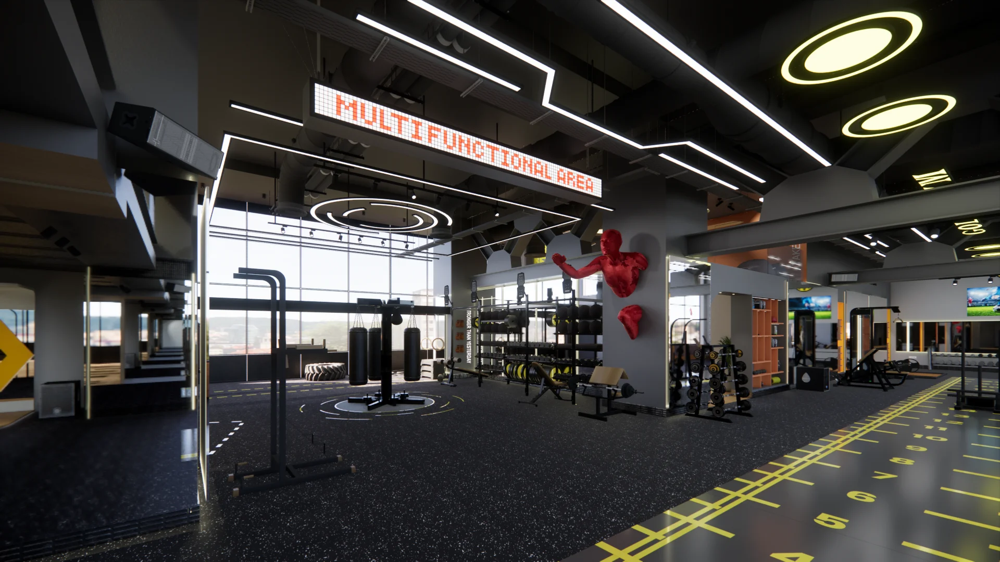
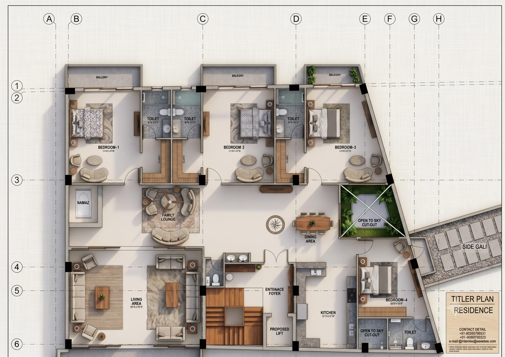
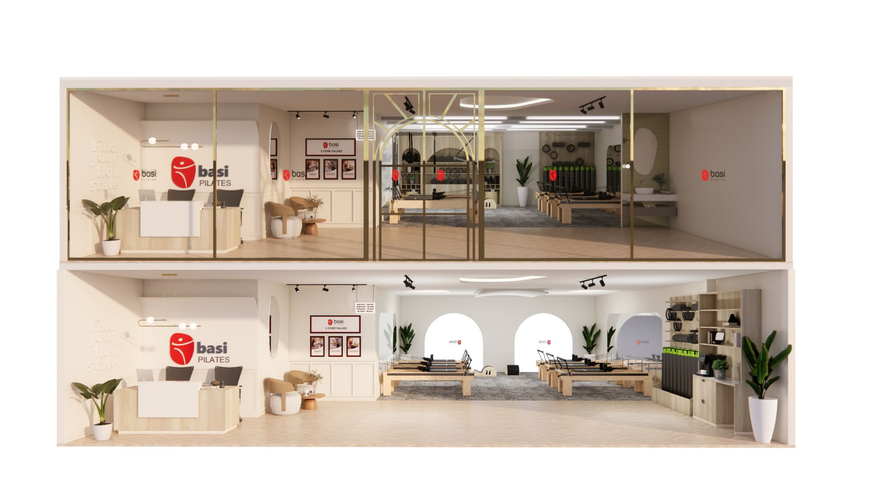
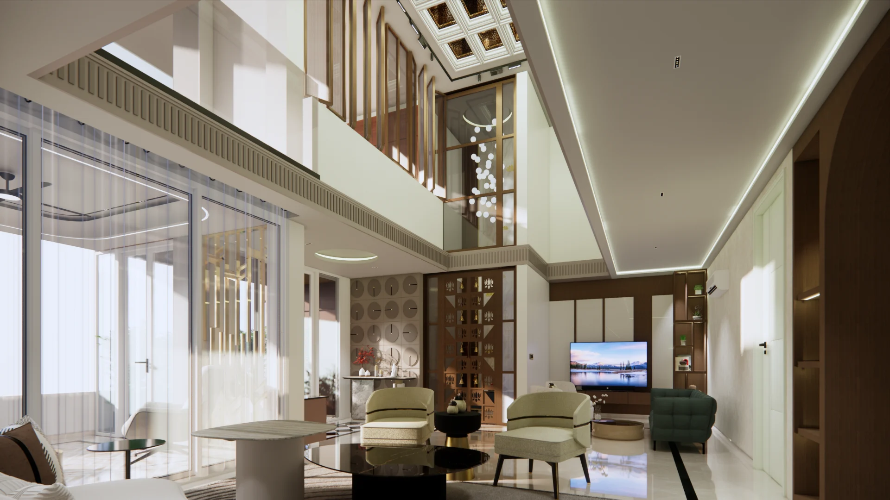
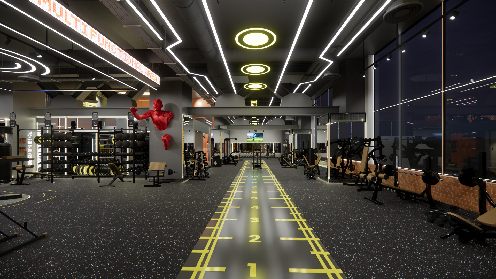

# greyspaces

Architecture and interiors. Calm, light-filled spaces, built to last.

**Live site:** [studiogreyspaces.com](https://studiogreyspaces.com) · [Instagram](https://www.instagram.com/greyspacesstudio) · [mail@studiogreyspaces.com](mailto:mail@studiogreyspaces.com)

<p align="center">
  <a href="https://studiogreyspaces.com">
    
  </a>
</p>

<p align="center">
  <a href="https://studiogreyspaces.com"><strong>Open the site</strong></a>
  &nbsp;·&nbsp;
  <a href="https://studiogreyspaces.com/moodboard">Moodboards</a>
  &nbsp;·&nbsp;
  <a href="https://studiogreyspaces.com/board/GYM-01">Gold’s Gym board</a>
</p>

Grey Spaces is a design studio for architecture and interiors. This repository is the public website and the client moodboard tool: a Next.js app that serves [studiogreyspaces.com](https://studiogreyspaces.com), with the copy, portfolio, and boards stored in this folder.

From the first sketch to the final finish, one team carries a project — balancing beauty, budget, and the way people actually live.

## Portfolio

A few of the spaces on the site. Each image links to [studiogreyspaces.com](https://studiogreyspaces.com).

| [Gold’s Gym, Hyderabad](https://studiogreyspaces.com) | [Residence, Hapur](https://studiogreyspaces.com) |
| --- | --- |
| <a href="https://studiogreyspaces.com"></a> | <a href="https://studiogreyspaces.com"></a> |
| Interiors · Hyderabad · 2026 | Architecture and interiors · Hapur · 2026 |

| [Basi Pilates](https://studiogreyspaces.com) | [B.P. colony residence, Delhi](https://studiogreyspaces.com) |
| --- | --- |
| <a href="https://studiogreyspaces.com"></a> | <a href="https://studiogreyspaces.com"></a> |
| Interiors · 2026 | Architecture and interiors · Delhi · 2024 |

## Moodboards

Clients open a private board, walk through the views, and leave a reaction or a note. Sample boards:

<p align="center">
  <a href="https://studiogreyspaces.com/board/GYM-01">
    
  </a>
</p>

<p align="center">
  <a href="https://studiogreyspaces.com/board/GYM-01">Gold’s Gym board (GYM-01)</a>
  &nbsp;·&nbsp;
  <a href="https://studiogreyspaces.com/board/SAMPLE">Sample board</a>
</p>

## What the site does

- Marketing home: studio story, services, portfolio, process, and an inquiry form
- Client moodboards at `/board` and `/board/[code]`, with likes and comments
- Admin at `/admin` for site copy, boards, uploads, inquiries, and feedback
- Content lives in `data/site.json`, `data/boards.json`, and `public/uploads/`

## Stack

Next.js 16, React 19, Tailwind CSS, and Three.js for the home scene. Production runs under PM2 on port 3005. HTTPS is terminated by Traefik, with an nginx config for the same upstream.

## Run it locally

```bash
cp .env.example .env.local
# Fill ADMIN_USERNAME, ADMIN_PASSWORD, and ADMIN_SESSION_SECRET in .env.local
npm install
npm run dev
```

Open [http://localhost:3000](http://localhost:3000). Admin login is [http://localhost:3000/admin/login](http://localhost:3000/admin/login).

Production build:

```bash
npm run build
npm run start -- -p 3005
```

Or with PM2, from this directory: `pm2 start ecosystem.config.cjs`.

## Deploy

| File | What it does |
| --- | --- |
| `ecosystem.config.cjs` | PM2 app `moodboard`, listening on port 3005 |
| `nginx-studiogreyspaces.conf` | `studiogreyspaces.com` → `127.0.0.1:3005` |
| `traefik-studiogreyspaces.yml` | Traefik route: HTTPS plus HTTP → HTTPS, same upstream |
| `.env.example` | Variables to copy into `.env.local` |
| `.env.production` | Public site URL |

Point the DNS A record for `studiogreyspaces.com` at the host, then either install the nginx file or drop the Traefik file into Traefik’s dynamic directory.

Do not commit `.env.local` or `data/inquiries.json`. Those hold the admin secret and customer contact details.

## Layout

```
app/                 pages and API routes
components/          home, boards, admin
data/site.json       homepage copy and portfolio
data/boards.json     moodboards
public/uploads/      studio, portfolio, and board images
lib/                 auth, storage, site schema
```
